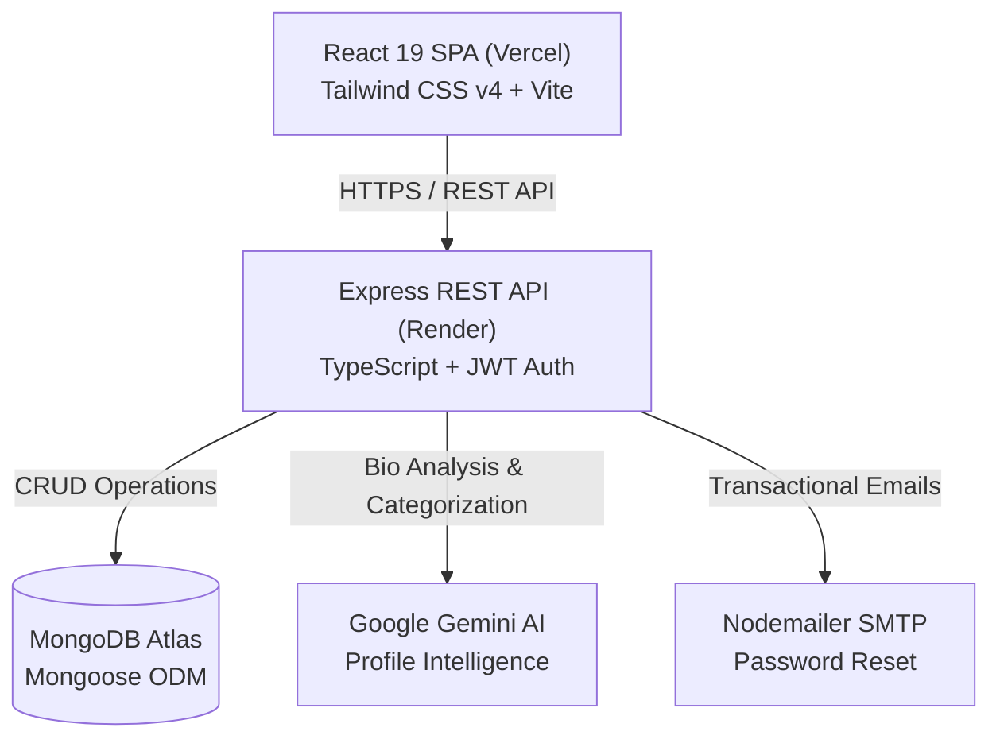

# 🚀 InstaCRM — Instagram Lead Management & Outreach Engine

<div align="center">

[](https://leadinsta-crm.vercel.app/)
[](https://leadinsta-crm.vercel.app/)
[](https://leadinsta-crm.vercel.app/)
[](https://leadinsta-crm.vercel.app/)
[](https://leadinsta-crm.vercel.app/)

<p align="center">
  <b>A modern, high-performance CRM built for creators, growth agencies, and social sales teams to manage Instagram lead pipelines, automate follow-up workflows, and accelerate conversion rates.</b>
</p>

[**Explore Live Application →**](https://leadinsta-crm.vercel.app/)

</div>

---

## 📌 Executive Summary

**InstaCRM** is an enterprise-grade social sales pipeline application designed to eliminate lead drop-offs, streamline Instagram direct messaging, and automate customer relationship workflows.

The system guides outreach teams through the entire lead lifecycle:
$$\text{Prospect Discovery} \longrightarrow \text{AI Qualification} \longrightarrow \text{Initial Contact} \longrightarrow \text{Scheduled Follow-Ups} \longrightarrow \text{Deal Conversion}$$

---

## 🌐 Live Deployment

* **Production Frontend (Vercel):** [https://leadinsta-crm.vercel.app/](https://leadinsta-crm.vercel.app/)
* **Production Architecture:** Fully decoupled client-server model with high-speed edge distribution on Vercel and containerized API services on Render.

---

## 🌟 Key Engineering Highlights

### 1. 🛡️ NIST & OWASP Compliant Security & Authentication
- **RFC 5322 Standard Email Verification**: Rigorous syntax validation with valid TLD requirement, length boundary checks (max 254 characters), and consecutive dot prevention.
- **5-Tier Password Security Standard**: Enforces $\ge 8$ characters, mixed uppercase/lowercase, numeric digits, and special characters.
- **Live Interactive Password Strength Meter**: Real-time 5-segment visual strength progress bar and interactive requirement checklist.
- **Contextual & Weak Wordlist Blacklist**: Blocks easily guessed passwords (e.g., `password123`, `qwerty1234`) and rejects passwords containing the user's email username.
- **Password Visibility Toggles**: Interactive show/hide eye buttons on all authentication inputs.
- **Secure Cryptography**: Password hashing using `bcryptjs` (salt rounds = 10) and stateless authentication via JSON Web Tokens (`JWT`, 7-day expiration).
- **Cryptographic Password Reset**: Secure SHA-256 token generation with 1-hour expiration and automated SMTP dispatch.

### 2. 🧠 Google Gemini AI Profile Analysis
- Automatic parsing of Instagram bios and activity data to extract prospect gender, profession, industry niche, and engagement potential.
- Dynamic tagging and lead categorization for customized cold outreach.

### 3. ⏱️ Automated Follow-Up Scheduling Engine
- Automated `nextFollowUpDate` and `followUpDueAt` calculations based on custom user settings (default: 2-day cadence, up to 4 follow-up rounds).
- Visual KPI status badges for leads **Due Today**, **Overdue**, and **Active Pipeline**.
- One-click status transitions: `New` $\rightarrow$ `Contacted` $\rightarrow$ `Follow-up 1` $\rightarrow$ `Follow-up 2` $\rightarrow$ `Interested` $\rightarrow$ `Converted`.

### 4. 💬 Integrated Instagram Outreach Dispatcher
- Direct deep-links to native Instagram profiles (`instagram.com/{username}`).
- Simulated DM launcher with personalized template interpolation (`{name}`, `{username}`, `{profession}`).
- Automated interaction logging and conversation history tracking.

### 5. ⚡ Enterprise Performance & Resilience
- **Decoupled Monorepo Structure**: Separate `frontend/` and `backend/` directories for modular scalability.
- **Universal CORS Middleware**: Dynamically authorizes requests across localhost, Vercel preview URLs, and production domains.
- **Self-Healing Database Connectivity**: Backend implements an automatic local fallback mechanism if the primary MongoDB Atlas URI is unreachable.
- **Instant Client Bundling**: Vite 6 build pipeline integrated with Tailwind CSS v4, yielding an ultra-lean 51 kB production CSS bundle.

---

## 🛠️ Technology Stack

| Layer | Technologies |
| :--- | :--- |
| **Frontend** | React 19, TypeScript, Vite 6, Tailwind CSS v4, Lucide Icons, Sonner |
| **Backend** | Node.js, Express.js, TypeScript, TSX Runtime |
| **Database** | MongoDB, Mongoose ODM |
| **AI & Automation** | Google Gemini Generative AI SDK (`@google/genai`) |
| **Authentication** | JWT (JSON Web Tokens), Bcrypt.js, Crypto |
| **Email Service** | Nodemailer (SMTP / Gmail Integration) |
| **Deployment** | Vercel (Frontend SPA), Render (Backend Web Service), MongoDB Atlas |

---

## 📐 System Architecture



---

## 📂 Project Directory Structure

```text
Instagram-crm/
├── frontend/                     # React + Vite Single Page Application
│   ├── src/
│   │   ├── components/           # UI Components (Auth, UserTable, UploadSection, etc.)
│   │   │   └── ui/               # Reusable primitives (Buttons, Cards, Modals, Badges)
│   │   ├── lib/                  # Utility helpers and class mergers
│   │   ├── services/             # Axios API client with dynamic URL resolution
│   │   ├── App.tsx               # Main application orchestration & layout
│   │   ├── main.tsx              # React DOM root entry point
│   │   └── index.css             # Tailwind CSS v4 design system
│   ├── .env.development          # Local dev environment (http://localhost:5000)
│   ├── .env.production           # Production environment (Render API)
│   ├── vercel.json               # SPA routing rules & rewrite configuration
│   └── vite.config.ts            # Vite build configuration with @tailwindcss/vite
├── backend/                      # Express + TypeScript API Server
│   ├── server.ts                 # API routing, business logic, and MongoDB models
│   ├── package.json              # Backend dependencies with tsx runtime
│   ├── tsconfig.json             # Backend TypeScript configuration
│   ├── .env                      # Local server configuration
│   └── .env.example              # Production environment template
├── render.yaml                   # Infrastructure blueprint for Render deployment
├── vercel.json                   # Root fallback routing for Vercel
└── package.json                  # Workspace orchestrator (build, dev, test scripts)
```

---

## 🔌 REST API Endpoints

### Authentication
| Method | Endpoint | Description | Security |
| :--- | :--- | :--- | :--- |
| `POST` | `/api/auth/signup` | Register new account with NIST/OWASP password checks | Public |
| `POST` | `/api/auth/login` | Authenticate user and issue JWT session token | Public |
| `GET` | `/api/auth/me` | Fetch authenticated user profile | Bearer JWT |
| `POST` | `/api/auth/forgot-password` | Generate cryptographic reset token and dispatch email | Public |
| `POST` | `/api/auth/reset-password` | Validate reset token and update password | Public |

### Lead Management
| Method | Endpoint | Description | Security |
| :--- | :--- | :--- | :--- |
| `GET` | `/api/users` | Retrieve paginated leads with status, tag, and due filters | Bearer JWT |
| `POST` | `/api/users/upload` | Bulk import leads from CSV/JSON datasets | Bearer JWT |
| `POST` | `/api/users/analyze` | Run Gemini AI analysis to infer profession and gender | Bearer JWT |
| `PATCH` | `/api/users/:id` | Update lead status, notes, or next follow-up date | Bearer JWT |
| `DELETE` | `/api/users/:id` | Delete an individual lead record | Bearer JWT |
| `POST` | `/api/users/bulk-delete` | Batch delete multiple leads | Bearer JWT |

### Templates, Messages & Logs
| Method | Endpoint | Description | Security |
| :--- | :--- | :--- | :--- |
| `GET` | `/api/templates` | Fetch outreach message templates | Bearer JWT |
| `POST` | `/api/templates` | Create a new message template | Bearer JWT |
| `POST` | `/api/messages/send` | Log sent message and advance follow-up counter | Bearer JWT |
| `GET` | `/api/logs` | Fetch chronologically sorted audit activity logs | Bearer JWT |
| `GET` | `/api/settings` | Get outreach delay, cadence, and safety preferences | Bearer JWT |
| `PATCH` | `/api/settings` | Update outreach cadence and safety parameters | Bearer JWT |

---

## 🚀 Getting Started (Local Development)

### Prerequisites
- [Node.js](https://nodejs.org/) (v18.0.0 or higher)
- [MongoDB](https://www.mongodb.com/) (running locally or a free MongoDB Atlas URI)
- Git

### 1. Clone the Repository
```bash
git clone https://github.com/<your-username>/Instagram-crm.git
cd Instagram-crm
```

### 2. Install Dependencies
```bash
# Install root dependencies
npm install

# Install frontend dependencies
cd frontend && npm install && cd ..

# Install backend dependencies
cd backend && npm install && cd ..
```

### 3. Configure Environment Variables

**Backend (`backend/.env`):**
```env
PORT=5000
NODE_ENV=development
MONGODB_URI="mongodb://127.0.0.1:27017/instasmart"
JWT_SECRET="your_secure_development_secret_key_123"
FRONTEND_URL="http://localhost:5173"

# Optional SMTP for password reset emails:
SMTP_HOST="smtp.gmail.com"
SMTP_PORT=587
SMTP_USER="your-email@gmail.com"
SMTP_PASS="your-app-password"
SMTP_FROM="your-email@gmail.com"
```

**Frontend (`frontend/.env.development`):**
```env
VITE_API_URL=http://localhost:5000
```

### 4. Run Development Servers
From the root directory:

```bash
# Start backend server (http://localhost:5000 with hot reload)
npm run dev:backend

# In a separate terminal, start frontend (http://localhost:5173)
npm run dev:frontend
```

---

## 🚢 Deployment Guide

### Deploying Frontend to Vercel
1. Import your GitHub repository into [Vercel](https://vercel.com).
2. Set the **Root Directory** to `frontend`.
3. In **Environment Variables**, configure:
   ```env
   VITE_API_URL = https://your-backend.onrender.com
   ```
4. Click **Deploy**. Vercel will build the SPA using the configured [frontend/vercel.json](file:///C:/Developer/Instagram-crm/frontend/vercel.json) rewrites.

### Deploying Backend to Render
1. Connect your repository to [Render](https://render.com).
2. Create a new **Web Service** or use the included [render.yaml](file:///C:/Developer/Instagram-crm/render.yaml) Blueprint:
   - **Root Directory:** `backend`
   - **Build Command:** `npm install`
   - **Start Command:** `npm start`
3. In **Environment Variables**, supply:
   - `MONGODB_URI`: Your production MongoDB Atlas cluster string.
   - `JWT_SECRET`: A cryptographically random secret string.
   - `FRONTEND_URL`: `https://leadinsta-crm.vercel.app`
   - `NODE_ENV`: `production`

---

## 📄 License

This project is open-source under the [MIT License](LICENSE). Built for enterprise lead management and scalable social outreach.
